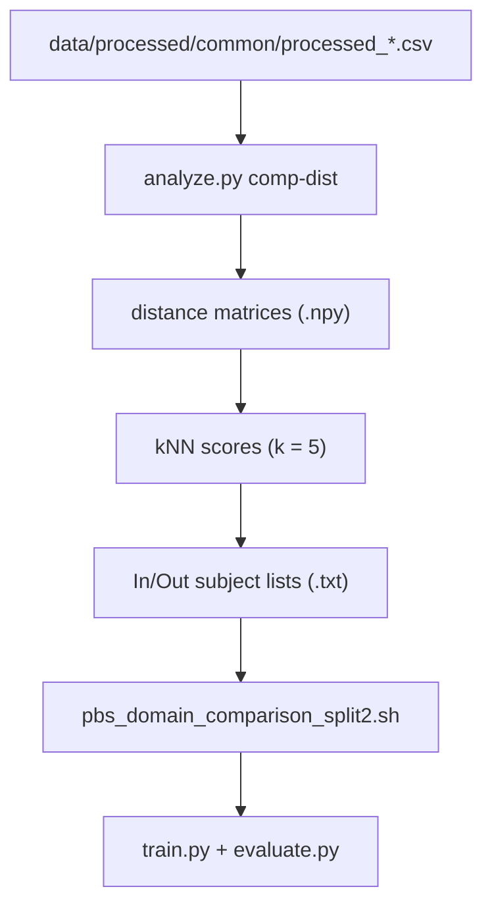

# Domain Generalization Analysis Pipeline

## Overview

This document explains how the subject grouping and the domain-shift runs of the paper are
produced.

The pipeline consists of three sequential stages:

1. **Distance computation**
   Compute subject-level distance matrices (MMD, Wasserstein, DTW) from the feature tables.
   → `scripts/python/analysis/analyze.py comp-dist` (`src/analysis/domain/distance.py`)

2. **Subject grouping**
   Score each subject-session by its mean distance to its k = 5 nearest neighbours and
   split the 87 subject-sessions into In (44) and Out (43).
   → `src/analysis/clustering_projection_ranked.py`; see
   [Ranking Methods](../reference/ranking_methods.md)

3. **Domain-specific training / evaluation**
   Train and evaluate the RF for each training mode on the groups.
   → `scripts/hpc/jobs/domain_analysis/pbs_domain_comparison_split2.sh`

---

## Pipeline Summary (High-Level)



---

## 1. Distance Computation

### Purpose

To compute pairwise subject distances using **three complementary metrics**:

* **MMD (Maximum Mean Discrepancy)** — feature distribution similarity
* **Wasserstein distance (W1)** — marginal feature distance
* **DTW (Dynamic Time Warping)** — temporal sequence alignment distance

### Entry Point

```bash
python scripts/python/analysis/analyze.py comp-dist \
    --subject_list config/subjects/subject_list.txt \
    --data_root data/processed/common \
    --groups_file config/subjects/target_groups.txt
```

Pass the three paths explicitly: the defaults of the command line are resolved relative
to `scripts/python/`.

### Core Function

```python
from src.analysis.domain.distance import run_comp_dist
```

### Data Flow

| Step | Function | Input | Output | Description |
|---|---|---|---|---|
| 1 | `_load_subject_list()` | `subject_list.txt` | List[str] | Read all subject IDs |
| 2 | `_extract_features_with_cache()` | `data/processed/common/processed_*.csv` | Dict[subj → np.ndarray] | Extract numeric feature arrays per subject (cached) |
| 3 | global z-score | Feature arrays | Feature arrays | Standardise every feature over all subjects |
| 4 | `_compute_distance_matrix()` | Feature arrays | `{metric}_matrix.npy`, `{metric}_subjects.json` | Subject-level distance matrix per metric |
| 5 | `_compute_group_analysis()` | Distance matrix + groups | Group-level summaries | Group distances, centroids, intra/inter dispersion |

### Output Structure

```
results/analysis/exp2_domain_shift/distance/
├── subject-wise/{mmd,wasserstein,dtw}/   # written by comp-dist
├── group-wise/                           # written by comp-dist
├── matrices/                             # matrices from which the paper's lists were derived
└── rankings/split2/knn/                  # In/Out lists used by the runs
```

`matrices/` and `rankings/split2/knn/` are distributed in the Zenodo bundle
(`DATADICTIONARY.md`, Section 5).

### Notes

* Cached feature arrays under `results/.cache/features_*.npz` accelerate repeated runs.
* Normalization: global z-score across all subjects before computing distances.

---

## 2. Subject Grouping

For each distance metric:

1. Load the distance matrix and subject list.
2. Score each subject-session by the mean of its k = 5 smallest distances to the others.
3. The 43 subject-sessions with the highest scores form `out_domain`, the other 44
   `in_domain`.

```
results/analysis/exp2_domain_shift/distance/rankings/split2/knn/
├── {distance}_in_domain.txt    # 44 subject-sessions
└── {distance}_out_domain.txt   # 43 subject-sessions
```

| Group | Meaning |
|---|---|
| `in_domain` | Most *typical* (domain-similar) subject-sessions |
| `out_domain` | Most *atypical* (domain-dissimilar) subject-sessions |

---

## 3. Domain-Specific Training

### Training Modes

| Mode | Description |
|------|-------------|
| **source_only** | Cross: train on the *opposite* group, evaluate on the test group |
| **target_only** | Within: train and evaluate within the *same* group |
| **mixed** | Mixed: train on *all 87 subject-sessions* (pooled), evaluate on the test group |

### Split2 Domain Logic

| Mode | Group | Training Data | Evaluation Data |
|---|---|---|---|
| source_only | out_domain | in_domain (44) | out_domain (43) |
| source_only | in_domain | out_domain (43) | in_domain (44) |
| target_only | out_domain | out_domain (43) | out_domain (43) |
| target_only | in_domain | in_domain (44) | in_domain (44) |
| mixed | out_domain | All (87) | out_domain (43) |
| mixed | in_domain | All (87) | in_domain (44) |

### PBS Execution

```bash
qsub -v CONDITION=baseline,MODE=source_only,DISTANCE=mmd,DOMAIN=out_domain,SEED=42 \
    scripts/hpc/jobs/domain_analysis/pbs_domain_comparison_split2.sh
```

The job reads the group list
`results/analysis/exp2_domain_shift/distance/rankings/split2/knn/${DISTANCE}_${DOMAIN}.txt`.
See the [Reproducibility Guide](../experiments/reproducibility.md) for the full design.

### Output Artifacts

```
models/{model}/{JOB_ID}/               # Trained model artifacts (not distributed)
results/outputs/evaluation/{model}/    # Evaluation records (JSON)
results/outputs/training/{model}/      # Training records
```

---

## 4. Extensibility

| Extension | How to Add | Affected Modules |
|---|---|---|
| **New distance metric** | Implement in `src/analysis/domain/distance.py` and add it to `DISTANCE_METRICS` in `src/config.py` | `analyze.py comp-dist` |
| **New ranking logic** | Add a `_rank_by_{method}` function | `src/analysis/clustering_projection_ranked.py` |
| **New group definition** | Edit `config/subjects/target_groups.txt` | `comp-dist` group summaries |

---

## References

* **MMD:** Gretton et al., *A Kernel Two-Sample Test*, JMLR (2012).
* **Wasserstein:** Villani, *Optimal Transport: Old and New*, Springer (2009).
* **DTW:** Berndt & Clifford, *Using Dynamic Time Warping to Find Patterns in Time Series*, AAAI Workshop on Knowledge Discovery in Databases (1994).

---

## Related Documents

- [Ranking Methods](../reference/ranking_methods.md) — Subject ranking algorithm details
- [Developer Guide](developer_guide.md) — Overall repository architecture
- [Reproducibility Guide](../experiments/reproducibility.md) — How to reproduce experiments
